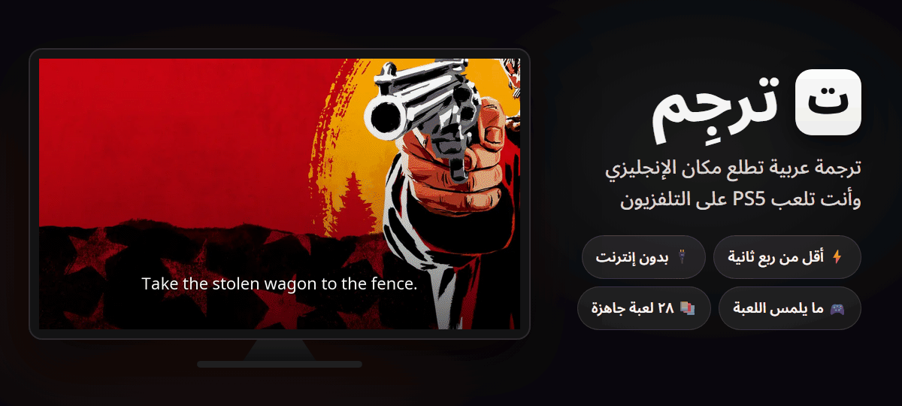
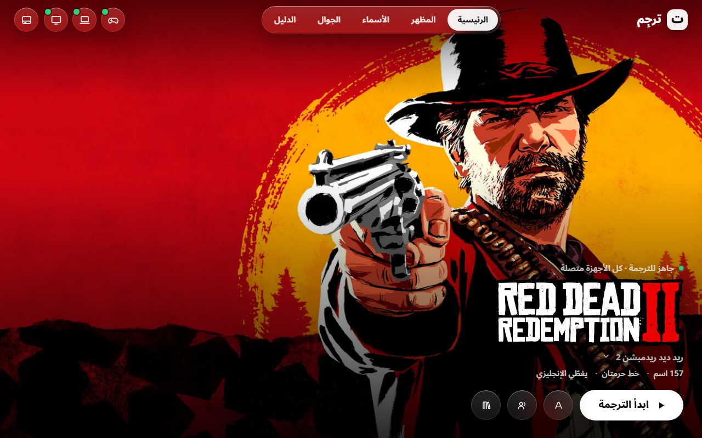
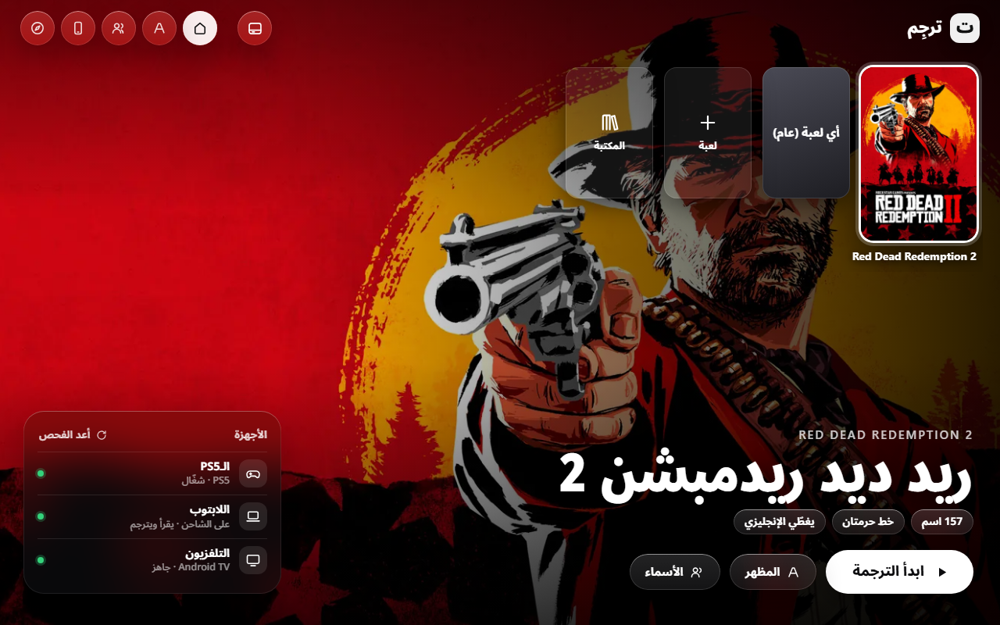
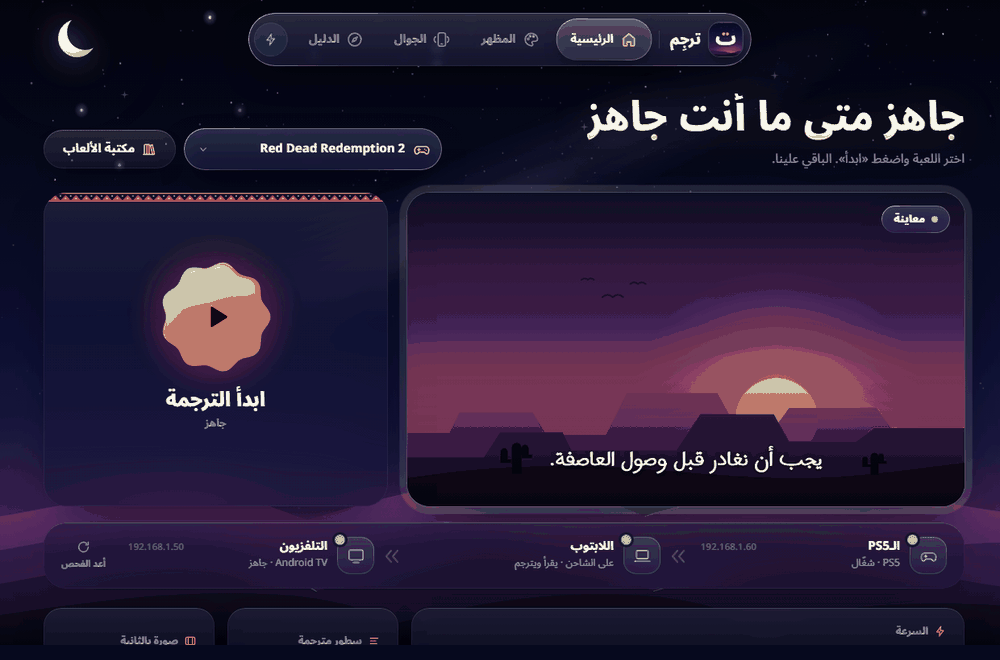
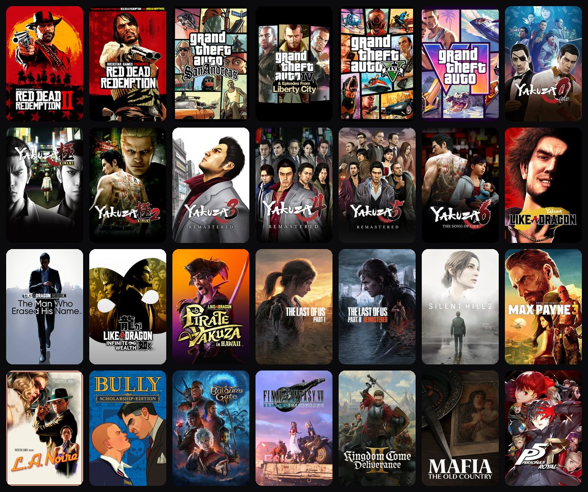
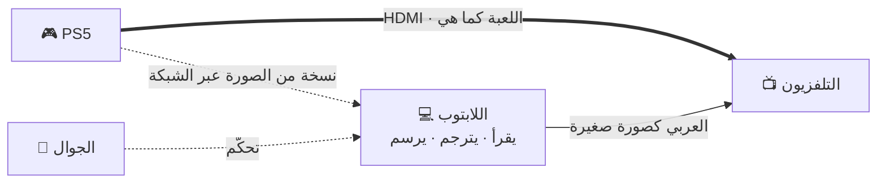
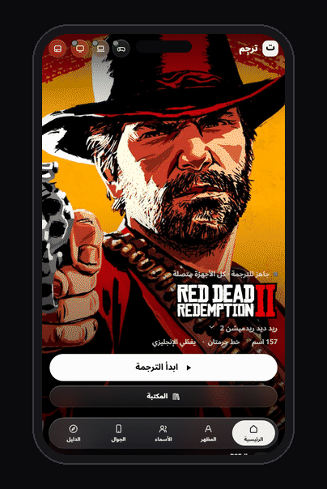

<div align="center" dir="rtl">



<br>

[](../../releases/latest)


[](#ai)

**[🎬 شوفه](#demo) · [✨ ليش ترجِم؟](#features) · [🗺️ كلمات الألعاب](#words) · [⬇️ التثبيت](#install) · [📱 الجوال](#phone) · [🤖 الذكاء الاصطناعي](#ai) · [❓ أسئلة](#faq)**

</div>

<div dir="rtl">

<a name="demo"></a>

## 🎬 وش يسوي؟

تلعب عادي على التلفزيون. أول ما يطلع سطر حوار بالإنجليزي، **ترجِم يمسحه ويكتب العربي مكانه**، بنفس المكان وبخط واضح. ما فيه شريط أسود، ولا شاشة ثانية تطالع فيها، ولا شي يتغيّر في لعبتك.

<p align="center">

</p>

<table>
<tr>
<td align="center" width="50%"><b>قبل</b><br></td>
<td align="center" width="50%"><b>بعد</b><br></td>
</tr>
</table>

<sub>هذي الصور مو رسم توضيحي: نفس كاشف السطور ونفس محرّك الرسم ونفس المترجم اللي يشتغلون على تلفزيونك هم اللي سوّوها.</sub>

<a name="features"></a>

## ✨ ليش ترجِم؟

<table>
<tr>
<td width="50%" valign="top">

### ⚡ سريع
العربي يطلع خلال **٠٫١٥ ثانية** من ظهور الإنجليزي. مقاسة في جلسة لعب حقيقية، مو تقدير.

</td>
<td width="50%" valign="top">

### 🔌 بدون إنترنت
القراءة والترجمة كلها داخل جهازك. ما يطلع شي برا بيتك.

</td>
</tr>
<tr>
<td valign="top">

### 🎮 ما يلمس اللعبة
الـPS5 يبقى موصول بالتلفزيون مثل ما هو. لا تأخير في اليد، ولا تغيير في الصورة.

</td>
<td valign="top">

### 🧠 يفهم كلام الألعاب
أسماء الشخصيات والأماكن، وكلمات كل لعبة: «the fence» يطلع «تاجر البضائع المسروقة» مو «السياج».

</td>
</tr>
<tr>
<td valign="top">

### 📚 مكتبة ٢٨ لعبة
قوائم جاهزة: ريد ديد، قراند (حتى GTA 6)، ياكوزا، ذا لاست أوف أس، بلدرز قيت، بيرسونا وغيرها. ضغطة وحدة وتنضاف.

</td>
<td valign="top">

### 👥 يعرف مين يكلّم
يكلّم الرجل بصيغة المذكر والمرأة بصيغة المؤنث، والجماعة بالجمع: «سايدي، راقبي الطريق».

</td>
</tr>
<tr>
<td valign="top">

### ✍️ عدّل بنفسك
ترجمة ما عجبتك؟ اكتبها بطريقتك مرة وحدة، وتطلع كذا كل مرة.

</td>
<td valign="top">

### 📱 من الكنبة
تحكّم من جوالك، أو استخدم [نسخة الجوال](https://github.com/aketo1/tarjim-phone) اللي ما تحتاج لابتوب أصلاً.

</td>
</tr>
</table>

## 🖼️ الشكل

لعبتك هي الخلفية: صورة اللعبة الرسمية ورا الصفحة، ووقت الترجمة يصير وراها البث المباشر اللي يشوفه البرنامج. وتختار بين شكلين:

<table>
<tr>
<td align="center" width="50%"><b>🎬 سينما</b><br><sub>صورة اللعبة تملأ الشاشة وفوقها أزرار قليلة</sub><br></td>
<td align="center" width="50%"><b>🗂️ رف الألعاب</b><br><sub>ألعابك بأغلفتها في صف مثل شاشة البلايستيشن</sub><br></td>
</tr>
</table>

<details>
<summary><b>🎞️ جولة سريعة في الشاشات</b> (اضغط)</summary>
<br>
<p align="center"></p>

- **الرئيسية:** زر واحد، والسطر اللي يطلع على تلفزيونك الحين، وحالة الأجهزة، وآخر السطور مع قلم لتعديل أي ترجمة.
- **المظهر:** الخط والحجم واللون والخلفية والموضع لكل لعبة، والمعاينة قدّامك وأنت تغيّر. ولو الترجمة شغّالة، التغيير يطلع على التلفزيون فوراً.
- **المكتبة:** قوائم الأسماء الجاهزة للألعاب، وتقدر تحدّث قائمتك لما ينزل لها جديد.

</details>

<a name="words"></a>

## 🗺️ كلمات الألعاب

المترجم العادي يترجم الكلمة بمعناها في القاموس، والألعاب لها كلامها الخاص. ترجِم يعرف وش تقصد اللعبة **قبل** ما يترجم: الأماكن والعصابات، والأفعال، وعامية الويسترن والمافيا والشوارع، والإنجليزي القديم حق ألعاب القرون الوسطى.

| بالإنجليزي | قبل | الحين |
| --- | --- | --- |
| <span dir="ltr">Take the stolen wagon to the fence.</span> | خذ العربة المسروقة إلى **السياج**. | خذ العربة المسروقة إلى **تاجر البضائع المسروقة**. |
| <span dir="ltr">Lose the law before you go back to camp.</span> | **اخسر القانون** قبل أن تعود إلى المخيم. | **اهرب من الشرطة** قبل العودة إلى المخيم. |
| <span dir="ltr">He's a made man now, nobody touches him.</span> | إنه **رجل مصطنع** الآن، لا أحد يلمسه. | إنه **عضو كامل في المافيا** الآن لا أحد يلمسه. |
| <span dir="ltr">Lucia, you strapped?</span> | لوسيا، هل أنت **مربوطة**؟ | لوسيا، أأنت **مسلّحة**؟ |
| <span dir="ltr">Nice whip, bro.</span> | **سوط** جميل يا أخي. | **سيارة** جميلة يا أخي. |

<details>
<summary><b>🔎 أمثلة أكثر</b> (اضغط)</summary>
<br>

| بالإنجليزي | قبل | الحين |
| --- | --- | --- |
| <span dir="ltr">We'll case the bank tomorrow.</span> | سوف **نقاضي** البنك غداً. | سوف **نستكشف** البنك غداً. |
| <span dir="ltr">He's packing a heater, be careful.</span> | إنه **يحزم المدفأة**، كن حذراً. | إنه **يحمل مسدساً**، كن حذراً. |
| <span dir="ltr">We gotta hit a lick tonight.</span> | علينا أن **نلعق** الليلة. | يجب أن **نقوم بسرقة** الليلة. |
| <span dir="ltr">The jig is up, Dutch.</span> | **الرقصة جاهزة** يا داتش. | **لقد انتهى الأمر** يا داتش. |
| <span dir="ltr">We found moonshine in his garage.</span> | وجدنا **ضوء القمر** في مرآبه. | وجدنا **كحول غير قانوني** في مرآبه. |
| <span dir="ltr">Mayhap the bailiff knows something.</span> | **مايهاب** الحاجب يعرف شيئا. | **ربما** المأمور يعرف شيئاً. |
| <span dir="ltr">Go to class or you'll get detention.</span> | اذهب إلى الصف وإلا **ستعتقل**. | اذهب إلى الصف وإلا **ستعاقب بعد المدرسة**. |
| <span dir="ltr">Uncle, get up, we're leaving.</span> | **العم**، انهض، نحن راحلون. | **يا عم**، انهض، نحن راحلون. |

<sub>كل الترجمات هنا طلعت من البرنامج نفسه: «قبل» هي ترجمته قبل ما تنضاف له كلمات الألعاب، و«الحين» بعدها.</sub>

</details>

<p align="center"></p>

<details>
<summary><b>📚 الألعاب الـ٢٨ في المكتبة</b> (اضغط)</summary>
<br>

- **ريد ديد:** ريد ديد ريدمبشن ١ و٢
- **قراند:** سان أندرياس، GTA 4، GTA 5، و**GTA 6** (أسماؤها من موقع روكستار الرسمي والعروض، مو من التسريبات)
- **ياكوزا / لايك أ دراغون:** صفر، كيوامي ١ و٢، ٣، ٤، ٥، ٦، لايك أ دراغون، قايدن، إنفنت ويلث، والقراصنة
- **ذا لاست أوف أس:** الجزء الأول والثاني
- **وغيرها:** سايلنت هيل ٢، ماكس باين ٣، إل.إيه. نوار، بولي، بلدرز قيت ٣، فاينل فانتسي ٧ ريميك/ريبيرث، كينقدم كم ٢، مافيا: ذا أولد كنتري، بيرسونا ٥ رويال

</details>

## ⚙️ كيف يشتغل؟

</div>



<div dir="rtl">

1. **اللابتوب يشوف الصورة:** ياخذ نسخة من صورة الـPS5 عن طريق شبكة البيت، بحساب PSN ثاني عشان يدك تبقى شغّالة.
2. **يقرأ ويترجم:** يلقط السطر الإنجليزي أول ما يطلع، ويترجمه محلياً مع أسماء اللعبة وكلماتها.
3. **التلفزيون يرسم:** تطبيق صغير على التلفزيون يحط العربي فوق مكان الإنجليزي. ولو صار أي خلل، العربي يختفي لحاله خلال ثانية.

<a name="install"></a>

## ⬇️ التحميل والتثبيت

<p align="center"></p>

في [صفحة الإصدارات](../../releases/latest) ثلاث ملفات:

| الملف | لمين |
| --- | --- |
| **`Tarjim-Setup-0.4.2.exe`** | **اللابتوب أو الكمبيوتر** (ويندوز ١٠ أو ١١، ٦٤-بت). فيه البرنامج والمترجم وبرنامج الشاشة، حوالي ٦٧٠ ميقا |
| **`Tarjim-TV-0.4.2.apk`** | **التلفزيون**: برنامج الشاشة لحاله. اللابتوب يركّبه لحاله من الدليل، وهذا لو تبي تركّبه بنفسك |
| **`Tarjim-Phone-Remote-0.4.2.apk`** | **الجوال**: تتحكم باللابتوب من الكنبة |

وتبي الجوال يسوي كل شي بدون لابتوب؟ [ترجِم للجوال](https://github.com/aketo1/tarjim-phone/releases/latest).

1. شغّل `Tarjim-Setup-0.4.2.exe` واضغط **«ثبّت ترجِم»**. ما يحتاج صلاحيات مدير، وياخذ أقل من دقيقة.
2. افتح ترجِم. أول مرة يمشّيك **الدليل** خطوتين، مرة وحدة بس:
   - **التلفزيون:** تكتب عنوانه، والبرنامج يركّب برنامج الشاشة ويفعّله.
   - **الـPS5:** تسجّل دخول بالحساب الثاني في صفحة Sony وتكتب رقم الربط.
3. اختر لعبتك واضغط **«ابدأ الترجمة»**. خلاص.

> 🛡️ **المتصفح أو ويندوز قال إن الملف «غير معروف» أو طلعت «حماية Windows»؟** هذا لأن البرنامج جديد وما عليه توقيع رقمي مدفوع، مو لأن فيه فيروس (فحصناه بـ Microsoft Defender: نظيف).
> - **في المتصفح:** من قائمة الملف اختر «الاحتفاظ» ثم «الاحتفاظ على أي حال».
> - **عند التشغيل:** اضغط **«مزيد من المعلومات»** ثم **«التشغيل على أي حال»**.

<details>
<summary><b>📺 تركيب برنامج الشاشة بدون لابتوب</b> (اضغط)</summary>
<br>

1. انسخ `Tarjim-TV-0.4.2.apk` على فلاش، وشبّكه في التلفزيون.
2. افتحه من أي تطبيق ملفات على التلفزيون واضغط «تثبيت» (لو سألك، اسمح للتطبيق يثبّت من مصادر غير معروفة).
3. افتح «ترجِم» من تطبيقات التلفزيون واضغط **«الإعدادات»**، وفعّل ترجِم من **إمكانية الوصول**.
4. اضغط **«جرّب سطر»**: لو طلع سطر عربي تحت الشاشة، التلفزيون جاهز.

</details>

<details>
<summary><b>🧰 وش تحتاج؟</b> (اضغط)</summary>
<br>

- لابتوب أو كمبيوتر ويندوز ١٠ أو ١١ (٦٤-بت)، **وعلى الشاحن** وقت اللعب.
- تلفزيون Android TV أو Google TV مفعّل فيه «تصحيح أخطاء USB» (مجرّب على TCL C635).
- PS5، وحساب PSN ثاني مجاني.
- الثلاثة على نفس شبكة البيت.

للإزالة: إعدادات ويندوز ‹ التطبيقات ‹ ترجِم ‹ إزالة.

</details>

<a name="phone"></a>

## 📱 من الجوال

<table>
<tr>
<td width="44%" align="center"></td>
<td valign="middle">

**تحكّم من الكنبة:** فعّل «التحكم من الجوال»، امسح المربع بكاميرا جوالك، وخلاص: نفس الواجهة في يدك، ومعها «شاشة ثانية» تعرض السطر العربي بخط كبير. يشتغل داخل شبكة بيتك فقط وبرمز ربط.

**أو بدون لابتوب أصلاً:** [ترجِم للجوال](https://github.com/aketo1/tarjim-phone) يسوي كل الشغل من الجوال لحاله: يقرأ ويترجم ويرسم على نفس التلفزيون.

</td>
</tr>
</table>

<a name="ai"></a>

## 🤖 انبنى بمساعدة الذكاء الاصطناعي

**ترجِم انبنى بمساعدة الذكاء الاصطناعي:** الفكرة والطلبات من صاحب المشروع بالعربي، و**Claude** (من Anthropic، عن طريق Claude Code) يكتب الكود ويجرّبه ويقيس سرعته ويصلّح أخطاءه. وساعد **Gemini** من Google في جولة تحسين العربي.

| اليوم | وش صار |
| --- | --- |
| ١٥ نوفمبر ٢٠٢٦ | أول نسخة تشتغل: العربي يطلع على التلفزيون فوق اللعبة |
| ١٦ نوفمبر | نسخة التثبيت، ونسخة الجوال اللي ما تحتاج لابتوب |
| ١٧ نوفمبر | مكتبة الألعاب، والإكس بوكس (تجريبي) |
| ١٨ نوفمبر | الشكل الجديد بصور الألعاب، عربي أوضح، ترجمة أسرع، كلمات ٢٨ لعبة، والإصدار 0.4.2 |

<sub>كل رقم في هذي الصفحة مقاس، وكل صورة وGIF فيها مصنوعة بكود البرنامج نفسه (`laptop/launcher/make_readme_media.py`).</sub>

<a name="faq"></a>

## ❓ أسئلة سريعة

<details>
<summary><b>يأخّر اللعبة أو اليد؟</b></summary>
<br>
لا. ما فيه شي من ترجِم بين الـPS5 والتلفزيون، اللعبة تمشي مثل ما هي.
</details>

<details>
<summary><b>ليش أحتاج حساب PSN ثاني؟</b></summary>
<br>
لأن الـPS5 يفصل يدك لو اتصل اللابتوب بنفس حسابك. الحساب الثاني (مجاني) للنسخة بس، لا تلعب فيه.
</details>

<details>
<summary><b>الترجمة صارت أبطأ من العادة؟</b></summary>
<br>
غالباً اللابتوب على البطارية. شبّك الشاحن.
</details>

<details>
<summary><b>اسم شخصية أو مكان يطلع غلط؟</b></summary>
<br>
أضفه في «الأسماء». ولأسماء النساء علّم ♀ عشان تطلع أفعالها مؤنثة. وتقدر تشارك قائمتك كملف مع أي أحد.
</details>

<details>
<summary><b>أبي قائمة جاهزة للعبتي؟</b></summary>
<br>
افتح «المكتبة» من الرئيسية واضغط «أضف». وصلك ملف لعبة من أحد؟ افتحه من «الأسماء» ‹ «استورد ملف»: الجديد ينضاف، واللي كتبته أنت يبقى.
</details>

<details>
<summary><b>الترجمة تطلع قبل ما يكتمل السطر؟</b></summary>
<br>
فعّل «اللعبة تكتب النص حرف حرف» في «المظهر» ‹ التوقيت.
</details>

<details>
<summary><b>يشتغل مع الإكس بوكس؟</b></summary>
<br>
مكتوب كتجربة، لكن ما انجرّب على إكس بوكس حقيقي للحين.
</details>

<details>
<summary><b>وش اللي ما يسويه؟</b></summary>
<br>
ما يترجم القوائم والعدّادات، وما يقرأ الترجمات الداكنة أو الملوّنة بقوة. والترجمة من مترجم محلي صغير: ممتازة للجمل الواضحة، وأضعف في النكت والكلام الغريب.
</details>

</div>

---

<details>
<summary><b>For developers</b></summary>

Everything technical is in [`docs/REPORT.md`](docs/REPORT.md): architecture, the wire protocol, what was measured, known limits and the rules for changing the project.

```
laptop/      Python 3.12 package "tarjim" (pipeline + desktop app) and its tests
tv-app/      Android TV overlay app (Kotlin, no libraries)
phone-app/   Android phone remote (Kotlin WebView shell)
profiles/    one YAML file per game
packs/       the game library (generated from packs/source/*.txt)
docs/        report, decisions, protocol, licences
```

```powershell
cd laptop
uv sync                                  # environment
uv run pytest                            # 248 tests, no devices needed
python launcher/build_packs.py           # the game library, for this program and the phone app
python launcher/build.py                 # Tarjim.exe
python launcher/build_setup.py           # dist/Tarjim-Setup-<version>.exe
python launcher/shots.py                 # screenshots of the running app into out/
python launcher/make_media.py            # swap.gif, before.png, after.png
python launcher/make_readme_media.py     # the banner, the screens, the phone and the library pictures
```

The translation model (`models/`, about 460 MB) and the Android toolchain (`.tools/`) are not in git; the installer in Releases carries the model.

Built with the help of AI: Claude (Anthropic) through Claude Code, and Gemini (Google) for one round of Arabic wording.

Personal, non-distributed project. It builds on GPL-3.0 code and other licences listed in [`docs/LICENSES.md`](docs/LICENSES.md); read that before sharing it. The games' pictures belong to their publishers.

</details>
