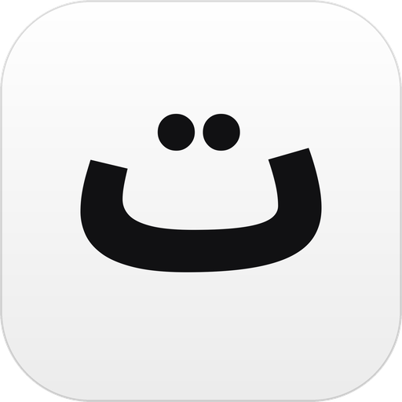
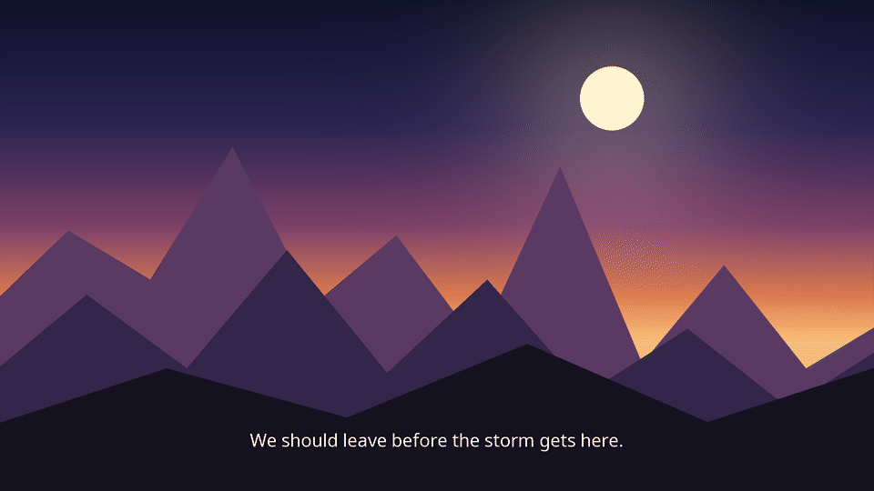
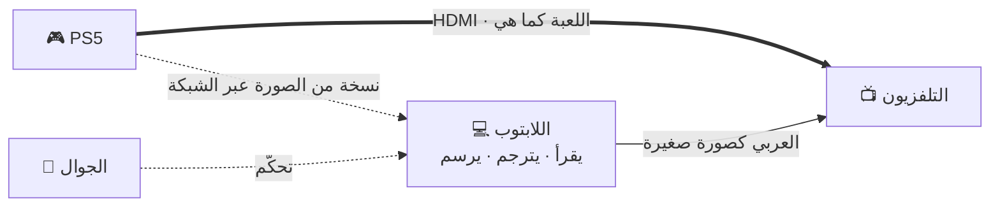
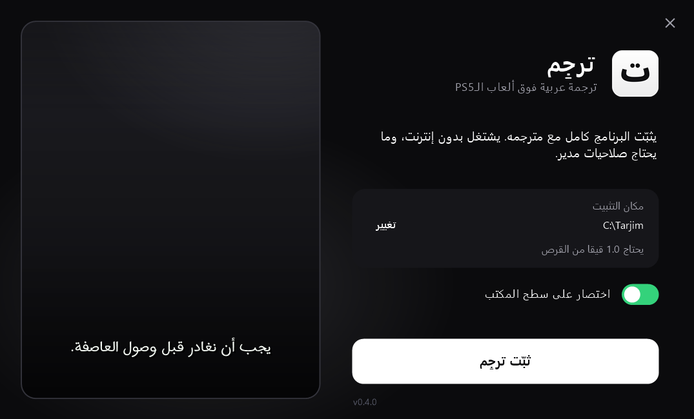
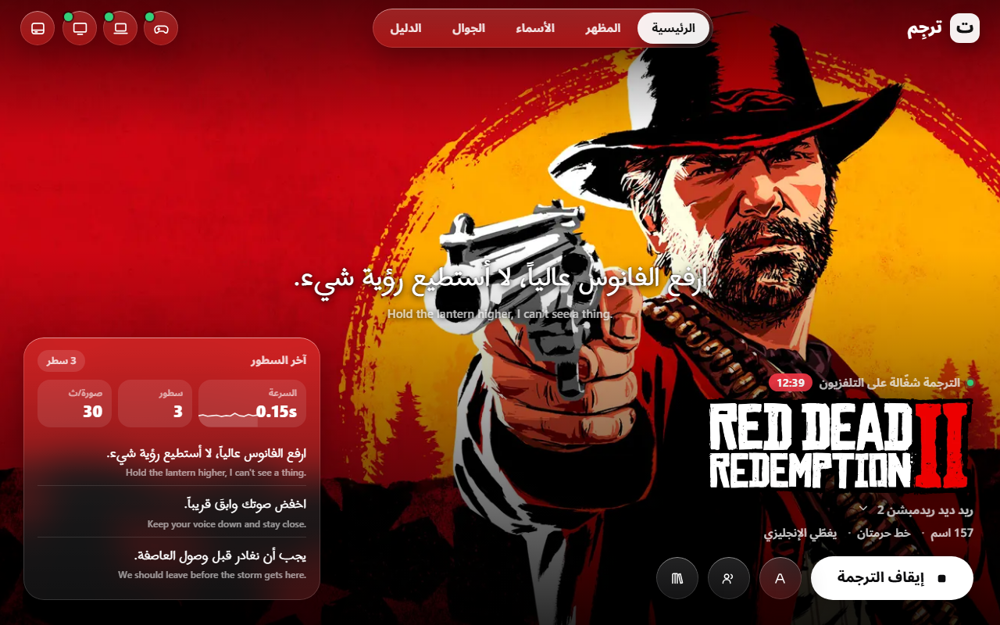
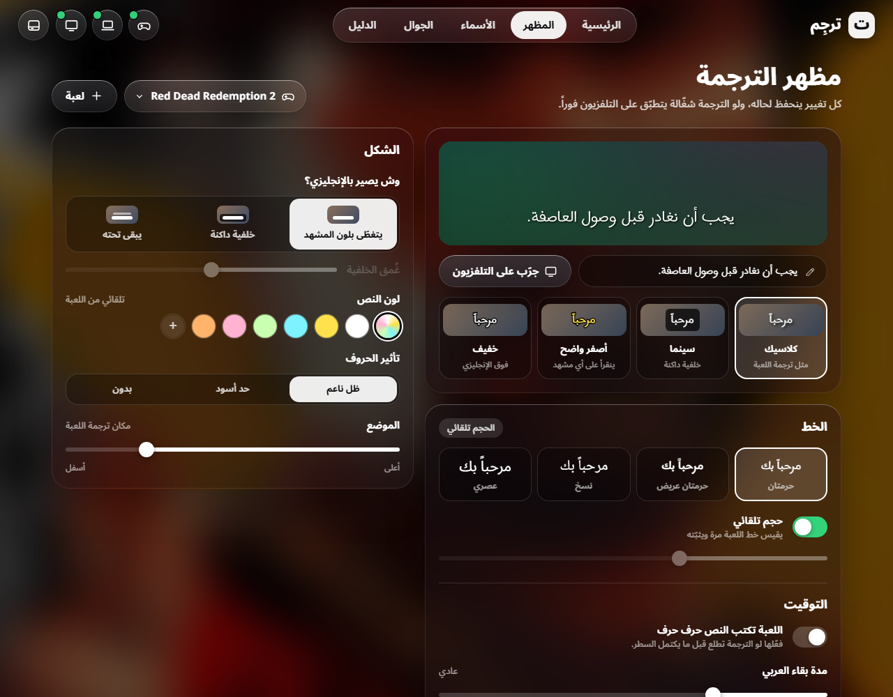
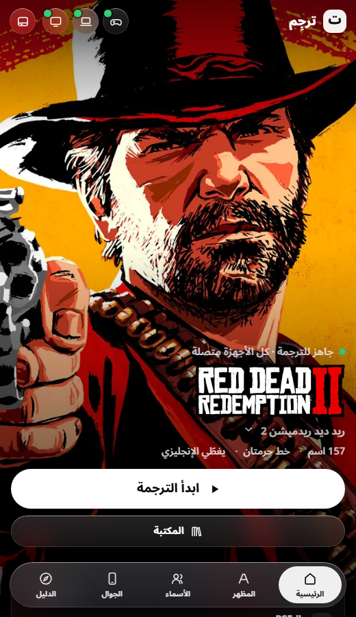
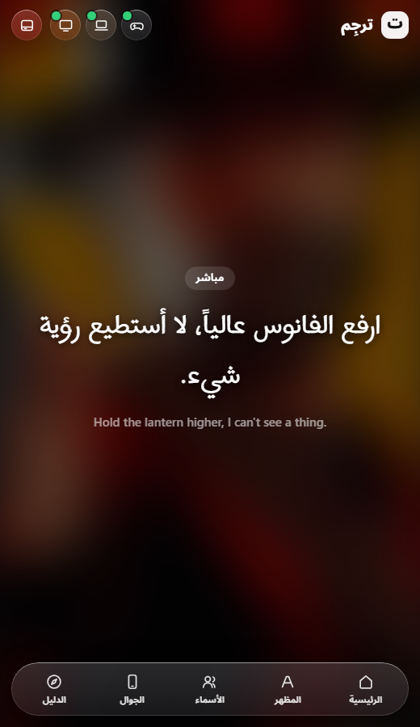

<div align="center" dir="rtl">



# ترجِم

**ترجمة عربية تطلع مكان الإنجليزية وأنت تلعب PS5 على التلفزيون.**

بدون إنترنت · بدون ما تلمس لعبتك أو يدك · العربي يطلع في أقل من ربع ثانية

<br>



<sub>هذا مو رسم توضيحي: نفس كاشف السطور ونفس محرّك الرسم اللي يشتغلون على تلفزيونك هم اللي سوّوا هذي الصورة.</sub>

<br><br>

### [⬇️ نزّل ترجِم للويندوز](../../releases/latest)

</div>

<div dir="rtl">

## وش يسوي؟

تلعب لعبتك عادي. أول ما يطلع سطر حوار بالإنجليزي، ترجِم يغطّي حروفه بلون المشهد ويكتب العربي في نفس المكان وبنفس الشكل. ما فيه شريط أسود، وما فيه شاشة ثانية تطالع فيها.

| | |
| --- | --- |
| ⚡ **سريع** | 0.15 ثانية (الوسيط) من ظهور الإنجليزي إلى ظهور العربي، مقاسة في جلسة لعب حقيقية |
| 🔌 **بدون إنترنت** | القراءة والترجمة كلها على اللابتوب |
| 🎮 **ما يلمس اللعبة** | الـPS5 يبقى موصّل بالتلفزيون بـHDMI مثل ما هو. لا تأخير في اليد ولا تغيير في الصورة |
| 🧾 **أسماء صح** | قاموس أسماء لكل لعبة، عشان «Dutch» يطلع «داتش» مو «الهولندية» |
| 📚 **مكتبة ألعاب** | قوائم أسماء جاهزة لـ28 لعبة ما فيها عربي: ريد ديد، قراند، ياكوزا، ذا لاست أوف أس، سايلنت هيل 2 وغيرها. ضغطة وحدة وتنضاف |
| 🔁 **شارك تعديلاتك** | صدّر ملف لعبتك (الأسماء والسطور اللي عدّلتها ومكان الترجمة) وأرسله لأي أحد، يفتحه في اللابتوب أو الجوال |
| ✍️ **تعدّل بنفسك** | ترجمة ما عجبتك؟ اكتبها بطريقتك مرة، وتطلع كذا كل مرة |
| 📱 **من الكنبة** | شغّل ووقّف وغيّر الشكل من جوالك |

## كيف يشتغل؟

</div>



<div dir="rtl">

1. **اللابتوب يشوف الصورة.** ياخذ نسخة من صورة الـPS5 عن طريق شبكة البيت (بحساب PSN ثاني، عشان يدك تبقى شغّالة).
2. **يقرأ ويترجم.** يلقط السطر الإنجليزي أول ما يطلع ويترجمه محلياً.
3. **التلفزيون يرسم.** تطبيق صغير على التلفزيون يحط العربي فوق مكان الإنجليزي. ولو صار أي خلل، العربي يختفي لحاله خلال ثانية.

## التحميل والتثبيت



1. افتح [صفحة الإصدارات](../../releases/latest) ونزّل **`Tarjim-Setup-0.3.0.exe`** (حوالي 650 ميقا، فيه كل شي: البرنامج والمترجم).
2. شغّله واضغط **«ثبّت ترجِم»**. ما يحتاج صلاحيات مدير، وياخذ دقيقة تقريباً.
3. افتح ترجِم. أول مرة يمشّيك **الدليل** خطوتين، مرة وحدة بس:
   - **التلفزيون:** تكتب عنوانه، والبرنامج يثبّت تطبيقه ويفعّله.
   - **الـPS5:** تسجّل دخول بالحساب الثاني في صفحة Sony وتكتب رقم الربط.
4. بعدها: اختر اللعبة واضغط **«ابدأ الترجمة»**.

> **ويندوز قال «حماية Windows»؟** لأن البرنامج شخصي وغير موقّع. اضغط **«مزيد من المعلومات»** ثم **«التشغيل على أي حال»**.

للإزالة: إعدادات ويندوز ‹ التطبيقات ‹ ترجِم ‹ إزالة.

## وش تحتاج؟

- لابتوب أو كمبيوتر ويندوز 10 أو 11 (64-بت)، **وعلى الشاحن** وقت اللعب.
- تلفزيون Android TV أو Google TV مفعّل فيه «تصحيح أخطاء USB» (مجرّب على TCL C635).
- PS5، وحساب PSN ثاني مجاني.
- الثلاثة على نفس شبكة البيت.

## جولة


لعبتك هي الخلفية: صورة اللعبة الرسمية ورا الصفحة، ووقت الترجمة يصير وراها البث المباشر اللي يشوفه البرنامج (٤ صور بالثانية، وقسناها: ما تأخر الترجمة). الأزرار زجاج شفاف وأبيض، بدون ألوان من عندنا. وتختار بين شكلين من الزر اللي في طرف الشريط فوق:

- **سينما**: صورة اللعبة تملأ الشاشة، وفوقها أزرار قليلة.
- **رف الألعاب**: ألعابك بأغلفتها في صف مثل شاشة البلايستيشن، واللي تختارها تصير الخلفية.

ونفس الشكلين في تطبيق الجوال.


### الرئيسية

زر واحد، وصورة لعبتك، والسطر اللي يطلع على تلفزيونك الحين فوقها، وحالة الأجهزة الثلاثة، وآخر السطور مع قلم لتعديل أي ترجمة.



### المظهر

لكل لعبة شكلها: الخط والحجم واللون والخلفية والموضع، والمعاينة قدّامك وأنت تغيّر. ولو الترجمة شغّالة، التغيير يطلع على التلفزيون فوراً.



### من الجوال

فعّل «التحكم من الجوال»، امسح المربع بكاميرا جوالك، وخلاص: نفس الواجهة في يدك، ومعها «شاشة ثانية» تعرض السطر العربي بخط كبير. يشتغل داخل شبكة بيتك فقط وبرمز ربط.

<p>

&nbsp;

&nbsp;

</p>

## أسئلة سريعة

**هل يأخّر اللعبة أو اليد؟** لا. ما فيه شي من ترجِم بين الـPS5 والتلفزيون.

**ليش حساب ثاني؟** لأن الـPS5 يفصل يدك لو اتصل اللابتوب بنفس حسابك. الحساب الثاني للنسخة بس، لا تلعب فيه.

**الترجمة أبطأ من المعتاد؟** غالباً اللابتوب على البطارية. شبّك الشاحن.

**اسم شخصية يطلع غلط؟** أضفه في «المظهر» ‹ قاموس الأسماء. ولأسماء النساء علّم ♀ عشان تطلع الأفعال مؤنثة.

**أبي قاموس جاهز للعبتي؟** افتح «مكتبة الألعاب» من الرئيسية واضغط «أضف». وصلك ملف لعبة من أحد؟ «المظهر» ‹ قاموس الأسماء ‹ «استورد ملف»: الجديد ينضاف، واللي كتبته أنت يبقى.

**الترجمة تطلع قبل ما يكتمل السطر؟** فعّل «اللعبة تكتب النص حرف حرف» في «المظهر» ‹ التوقيت.

**وش اللي ما يسويه؟** ما يترجم القوايم والعدّادات، وما يقرأ الترجمات الداكنة أو الملوّنة بقوة، وجودة الترجمة هي جودة مترجم محلي صغير: ممتازة للجمل الواضحة وأضعف في العامية والنكت.

</div>

---

## For developers

Everything technical is in [`docs/REPORT.md`](docs/REPORT.md): architecture, the wire protocol, what was measured, known limits and the rules for changing the project.

```
laptop/      Python 3.12 package "tarjim" (pipeline + desktop app) and its tests
tv-app/      Android TV overlay app (Kotlin, no libraries)
phone-app/   Android phone remote (Kotlin WebView shell)
profiles/    one YAML file per game
packs/       the game library (generated from packs/source/*.txt)
docs/        report, decisions, protocol, licences
```

```powershell
cd laptop
uv sync                              # environment
uv run pytest                        # 129 tests, no devices needed
python launcher/build_packs.py       # the game library, for this program and the phone app
python launcher/build.py             # Tarjim.exe
python launcher/build_setup.py       # dist/Tarjim-Setup-<version>.exe
python launcher/make_media.py        # the pictures in this README
```

The translation model (`models/`, about 460 MB) and the Android toolchain (`.tools/`) are not in git; the installer in Releases carries the model.

Personal, non-distributed project. It builds on GPL-3.0 code and other licences listed in [`docs/LICENSES.md`](docs/LICENSES.md); read that before sharing it.
